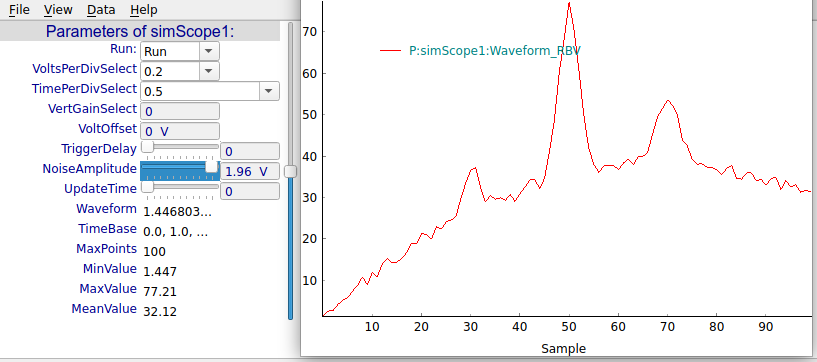

# pypeto
`pypeto` is a PyQt-based application designed for managing control screens for EPICS (Channel Access and PVAccess) and LiteServer devices. The architecture is modular, allowing for easy integration of various control pages through a tabbed interface.

- **Data Flow**:
  - The application communicates with EPICS and LiteServer devices to fetch and display process variables in real-time.
  - Configuration files are Python scripts that define the behavior and layout of control screens.

Features:
 - control of EPICS PVs and LiteServer PVs,
 - tabs: several control pages can be managed from one window,
 - automatic page generation for LiteServer devices,
 - AI-assisted page generation for EPICS PVAccess,
 - single configuration file can be used for many similar devices,
 - configuration files are python scripts,
 - snapshots: control page can be saved and selectively restored from the saved snapshots,
 - embedding os displays from other programs to a range of cells,
 - plotting of selected cells using pvplot,
 - merged cells, adjustable size of rows and columns, fonts and colors,
 - horizontal and vertical slider widgets,
 - content-driven cell coloring,
 - slicing of vector parameters.



## Examples:
### Control of a simulated oscilloscope from EPICS PVAccess infrastructure:<br>
Start server for a simulated image generator
```
python -m epicsdev.imagegen -r30
```
Start control page from [config/imagegen_pp.py](https://github.com/eicorg/epicsdev/blob/main/config/imagegen_pp.py):
```
python -m pypeto -c config -f imagegen_pp
```
### Control of a peak simulator from LiteServer infrastructure,
for more detalis see :<br>
```
# Start the liteServer of a peak simulator
python -m liteserver.device.litePeakSimulator -i localhost -p9701
# Start control page ./test/simScope_pp.py
python -m pypeto -c test -f peakSimPlot -e
```

### Two control pages in tabs:<br>
`python -m pypeto -c test -f peakSimLocal peakSimGlobal`

### Control of a simulated oscilloscope from EPICS Channel Access infrastructure 
[link](https://epics.anl.gov/modules/soft/asyn/R4-38/asynDriver.html#testAsynPortDriverApp):<br>
`python -m pypeto -c test -fsimScope -e`


